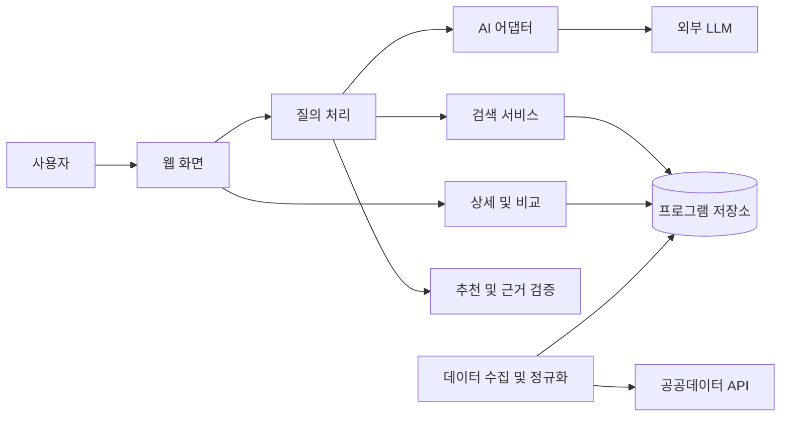

# 설계서 1장부터 3장까지의 초안

버전 0.2 · 2026-10-26 · 상태 실제 데이터 확인에 따른 설계 제안

교수님 SDD의 설계 개요, 시스템 아키텍처, 컴포넌트 설계에 대응한다. 실제 API의 12개 필드를 확인했으며, 아래 구성은 사용자용 서비스의 설계안이다. 구현된 API 검증 도구와 웹 서비스 구현을 구분한다.

## 1 설계 개요

관련 문서는 [계획서](project-plan.md), [요구사항](requirements.md), [유스케이스](use-cases.md), [데이터 검증](data-api-review.md)이다.

설계 목표는 실제 데이터에 근거한 답변, 데이터·AI 장애의 분리 처리, 소규모 팀이 구현할 수 있는 구조이다. 프론트엔드와 단일 백엔드를 사용하는 클라이언트-서버 구조를 제안한다. 백엔드 내부에서 역할을 모듈로 나누며 초기에는 마이크로서비스로 분리하지 않는다.

## 2 시스템 아키텍처



이 그림에서 연결선은 호출·의존 관계를 표시하며 단방향 데이터 전송만을 뜻하지 않는다. 검색 서비스가 검증된 후보를 질의 처리에 반환하고, 질의 처리가 추천 서비스와 AI 어댑터에 필요한 최소 정보를 전달한다.

### 데이터 흐름

1. 데이터 수집 모듈이 승인된 API를 호출한다. 응답을 검증·정규화하고 수집 시점과 출처를 보관한다. 모집 상태 필터가 검증 요청에서 적용되지 않아 전체 수집본에 서버 측 필터를 적용한다.
2. 사용자의 텍스트를 백엔드가 검증하고 AI 어댑터에 조건 추출을 요청한다.
3. 질의 처리 모듈이 구조화 결과를 검증하고 지원되는 조건만 검색 서비스에 전달한다.
4. 검색 서비스가 실제 저장 데이터에서 후보를 찾는다. 추천 요청이면 서버 규칙으로 일치 조건과 순위를 계산한다.
5. AI는 검증된 후보와 근거를 설명한다. 식별자·사실 값의 검증이 어려운 자유 생성 대신 서버가 관리하는 사실 필드와 구조화 설명을 조합한다.
6. 화면은 결과와 출처, 미상 항목을 표시한다. 비교는 선택 ID의 저장 데이터를 사용한다.

### 설계 결정 제안

| ID | 선택 | 이유 | 대안·제약 | 요구사항 |
|---|---|---|---|---|
| ADR-001 | 단일 백엔드 내부 모듈 분리 | 배포 부담을 줄이고 책임 구분 | 독립 확장성이 제한됨 | NFR-005 |
| ADR-002 | 구조화 데이터 검색 우선 | 조건 충족 여부를 검증하기 쉬움 | 의미 검색은 데이터 확인 후 판단 | FR-002, AI-REQ-02 |
| ADR-003 | 서버에서 추천 점수·근거 계산 | 미상 값을 충족으로 오인하지 않게 함 | 규칙·가중치는 합의 필요 | FR-003 |
| ADR-004 | 외부 API 데이터의 로컬 보관 | 질의마다 원천 API를 호출하는 부담 감소 | 갱신 지연·보관 조건 확인 필요 | FR-008, NFR-001 |

저장소 구현은 SQLite 등 관계형 DB를 후보로 검토하되 확정하지 않았다. 원본 고유 ID가 없고 완전 중복 3건이 관측되어 내부 ID와 중복·갱신 규칙을 별도로 결정한다. 전체 필드 해시는 완전 중복 탐지에 사용하며 수정 전후 동일 프로그램의 식별자로 단정하지 않는다. 수집 주기·오래된 데이터의 표시·수집 실패 시 처리도 실제 데이터 갱신 특성 확인 후 결정한다.

## 3 컴포넌트 설계

아래 인터페이스는 내부 계약 제안이다. 외부 API 명세 또는 구현된 함수가 아니다.

| ID | 컴포넌트 | 책임 | 입력 | 출력 | 의존성 | 요구사항 |
|---|---|---|---|---|---|---|
| COMP-01 | WebUI | 질의 입력, 조건 확인, 결과·상세·비교 표시 | 사용자 입력·선택 | 백엔드 요청, 화면 | COMP-02, COMP-07 | FR-001~FR-006, NFR-004 |
| COMP-02 | QueryService | 질의 흐름 조정, 조건 검증, 오류 응답 | QueryRequest | 검색·추천 결과와 적용 조건 | COMP-03~COMP-05 | FR-001~FR-003, FR-006, AI-REQ-01 |
| COMP-03 | AIAdapter | 조건 추출과 근거 설명, 출력 스키마·타임아웃 관리 | 텍스트 또는 검증된 후보·근거 | 구조화 조건·설명 | 외부 LLM | AI-REQ-01~03, NFR-001, NFR-005 |
| COMP-04 | ProgramSearch | 지원 조건으로 실제 레코드 검색 | SearchCriteria | 후보 목록 | COMP-06 | FR-002, FR-007 |
| COMP-05 | RecommendationService | 후보 정렬, 조건별 일치·미상 계산 | 후보·사용자 조건 | 순위·근거 | 검증된 후보와 정해진 규칙 | FR-003, AI-REQ-02 |
| COMP-06 | ProgramRepository | 프로그램 저장·조회와 출처·수집시점 보관 | 정규화 데이터·조회 조건 | 저장 결과·레코드 | 데이터 저장소 | FR-002, FR-005, FR-008 |
| COMP-07 | DetailComparisonService | ID 검증, 상세 조회·비교 데이터 구성 | 프로그램 ID 1개 또는 2~3개 | 상세 또는 공통 항목 비교 | COMP-06 | FR-004, FR-005, FR-007 |
| COMP-08 | DataIngestion | 페이지별 수집·검증·정규화·중복 처리 | API 응답 | 저장용 데이터·수집 요약 | COMP-09, COMP-06 | FR-008 |
| COMP-09 | PublicDataAdapter | 원천 API 요청과 업무 오류 판별 | 검증된 요청 인자·서버 인증정보 | 원천 응답 또는 명시적 오류 | 공공데이터 API | FR-008, NFR-001, NFR-002 |

### 주요 인터페이스 제안

```text
AIAdapter.extractCriteria(query) -> CriteriaExtraction
QueryService.search(query) -> SearchResult
ProgramSearch.find(criteria) -> ProgramCandidate[]
RecommendationService.rank(candidates, preferences) -> RankedCandidate[]
AIAdapter.explain(verifiedCandidates, verifiedReasons) -> ExplanationResult
DetailComparisonService.detail(id) -> ProgramDetail
DetailComparisonService.compare(ids) -> ComparisonResult
ProgramRepository.upsert(programs, fetchedAt) -> ImportSummary
DataIngestion.sync() -> SyncSummary
```

`SearchCriteria`에는 검증된 지원 조건만 둔다. 후보에는 내부 ID, 표시 정보, 출처, 수집 시점을 연결한다. 추천 결과는 일치 조건과 미상 조건을 구분한다. 타입의 실제 필드·날짜 판정·페이지 처리·오류 코드와 HTTP 엔드포인트는 데이터 검증 후 상세 설계에서 확정한다.

### 실패 처리

- 외부 API 실패: 실패를 기록하고 기존 유효 데이터를 잘못된 응답으로 덮어쓰지 않는다.
- 데이터 없음: 데이터 미수집과 검색 결과 0건을 구분한다.
- AI 비정상 출력: 스키마 검증 실패를 감지하고 재질문 또는 실패 안내를 제공한다.
- 근거 부족: 조건 충족을 확정하지 않고 미상으로 표시한다. 모집 상태와 날짜가 충돌하면 확인 필요로 표시하고 현재 모집 후보에서는 제외한다.
- 홈페이지 URL: HTTP(S) 형식과 호스트를 검사하고 누락·부적합 값은 링크로 만들지 않는다. 검증된 형식만으로 실제 신청 경로 또는 공식성을 보장하지 않는다.
- 키·원문 질의: 브라우저 번들·응답·로그에 인증키를 포함하지 않고 원문 질의를 기본 영구 저장하지 않는다.

## 후속 결정

- 내부 ID·갱신 식별 규칙과 원천 최종 갱신 시점, 홈페이지 도달 가능성
- 개발 프레임워크·DB·LLM 제공자와 비용
- 추천 조건·가중치·동점 규칙
- 수집 주기·실패 시 데이터 사용 정책
- 화면 와이어프레임과 AI 입출력 상세 스키마
- SDD 4장 이후 상세 UML·DB·HTTP API·보안·배포 설계
