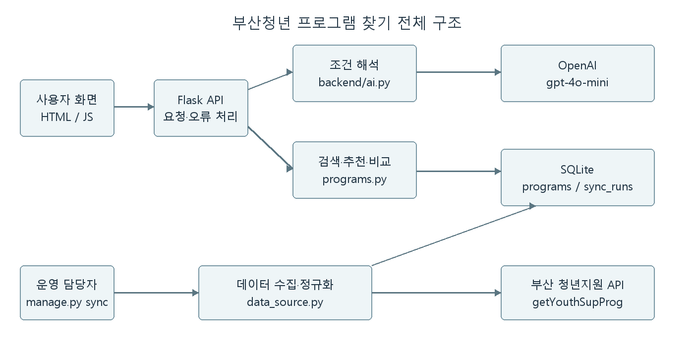
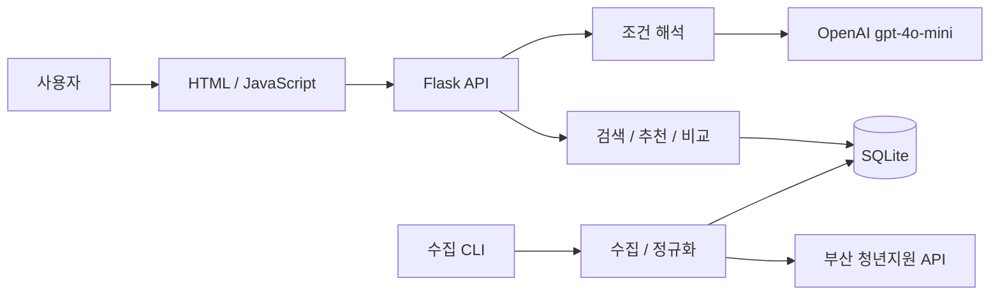

# 소프트웨어 설계서

버전 0.3 · 2026-10-26 · SDD 1~3장

## 1 설계 개요

### 1.1 목적과 범위

본 문서는 부산청년 프로그램 찾기의 실행 구조와 각 컴포넌트의 책임을 설명한다. [SRS](requirements.md)의 자연어 검색, 맞춤 추천, 비교 기능을 대상으로 한다. 로그인·신청 대행·지도는 포함하지 않는다.

백엔드와 화면을 하나의 Flask 서버에서 제공한다. 화면의 JavaScript가 같은 서버의 JSON API를 호출한다. DB는 서버 로컬 SQLite이며 외부 공공데이터와 OpenAI 키는 서버에서만 사용한다.

### 1.2 관련 문서

[프로젝트 계획서](project-plan.md), [요구사항명세서](requirements.md), [유스케이스](use-cases.md), [API 검증](data-api-review.md), [테스트 계획](test-plan.md).

### 1.3 설계 목표

| 목표 | 설계 대응 | 관련 요구사항 |
|---|---|---|
| 실제 데이터에 근거한 결과 | DB의 항목만 표시, 추천 이유는 규칙으로 계산 | AI-REQ-02 |
| 외부 장애 시 기존 데이터 보존 | 전체 수집 확인 후 트랜잭션으로 반영 | FR-008, NFR-001 |
| 설명 가능한 구성 | 단일 서버 내부를 설정·수집·DB·업무·AI로 분리 | NFR-005 |
| 적은 실행 준비 | SQLite와 일반 HTML/JS 사용 | NFR-004 |

## 2 시스템 아키텍처

### 2.1 전체 구조





외부 데이터를 수집하는 흐름과 사용자 검색 흐름을 분리한다. 검색할 때마다 공공데이터 API에 접속하지 않는다.

### 2.2 선택 이유와 제한

| 결정 | 이유 | 제한 |
|---|---|---|
| Flask 단일 서버 | 작은 팀에서 실행·통합하기 쉬움 | 대규모 배포·서비스 분리는 다루지 않음 |
| SQLite | 약 1,000건의 읽기 위주 데이터, 별도 서버 불필요 | 여러 서버의 동시 쓰기 환경에는 다른 DB 검토 필요 |
| 구조화 검색 | 분야·키워드·기간의 적용 여부를 확인하기 쉬움 | 의미가 비슷한 단어를 모두 찾아주지는 않음 |
| 서버에서 추천 점수 계산 | 각 추천 이유를 데이터와 연결할 수 있음 | 선호도를 학습하거나 효과를 보장하는 모델은 아님 |
| LLM 조건 추출 + 확인 화면 | 자연어를 지원하면서 오해석을 사용자가 수정 | 한 번 더 확인하는 과정이 필요 |

### 2.3 주요 처리 흐름

**수집:** 운영자가 `manage.py sync` 실행 → 100건씩 페이지 조회 → 전체 건수·페이지 검증 → 날짜·URL 정규화 → 완전 중복 제거 → 새 수집본을 한 트랜잭션으로 반영한다. 오류나 불완전 응답은 이전 유효 데이터를 유지한다.

**자연어 검색:** 질문 → OpenAI의 구조화 출력 → 서버 스키마·미지원 조건 검사 → 화면의 조건 폼 반영 → 사용자 확인 → DB 기반 검색 → 결과 표시이다. 원천 API의 모집 필터를 신뢰하지 않고 날짜와 상태를 직접 비교한다.

**추천:** 검색 후보에 분야 5점, 제목 키워드별 4점, 대상·기관 키워드별 1점, 대상 키워드 2점, 현재 신청기간 1점을 준다. 현재 신청기간인 항목을 우선하고 그 안에서 점수, 마감일, 내부 ID 순으로 정렬한다. 이유는 점수를 받은 조건에서만 작성한다.

**비교:** 서로 다른 ID 2~3개 검증 → 현재 수집본 조회 → 공통 필드 반환이다. 삭제되거나 갱신으로 비활성화된 ID는 다시 검색하도록 안내한다.

## 3 컴포넌트 설계

논리적인 책임을 기준으로 나누었다. 검색·추천·비교는 규모가 작아 한 파일 안의 함수로 구현했다.

| ID | 컴포넌트 / 파일 | 책임 | 입력 → 출력 | 의존성 | 요구사항 |
|---|---|---|---|---|---|
| COMP-01 | WebUI / frontend | 입력, 조건 수정, 결과·상세·비교 표시 | 사용자 입력 → API 요청·화면 | COMP-02 | FR-001~006, NFR-004 |
| COMP-02 | APIController / backend/__init__.py | 요청 검증, HTTP 오류, 처리 조정 | JSON → JSON·상태 코드 | COMP-03~07 | FR-001~007 |
| COMP-03 | QueryInterpreter / backend/ai.py | LLM 조건 추출, 스키마 검증, 미지원 조건 검사 | 질문·기준일 → 조건·확인사항 | OpenAI SDK | AI-REQ-01, AI-REQ-03 |
| COMP-04 | Search / backend/programs.py | 분야·키워드·신청기간 필터 | 조건·DB 레코드 → 후보 | COMP-06 | FR-002, FR-006, FR-007 |
| COMP-05 | Recommendation / backend/programs.py | 일치 점수·근거·순위 계산 | 후보·조건 → 점수·이유 | COMP-04 | FR-003, AI-REQ-02 |
| COMP-06 | ProgramRepository / backend/database.py | 저장·조회, 현재 수집본 관리 | 정규화 데이터·조건 → DB 결과 | SQLite | FR-002, FR-005, FR-008 |
| COMP-07 | DetailComparison / backend/programs.py | 상세 조회, 비교 개수·ID 검증 | ID 1개 또는 2~3개 → 확인된 필드 | COMP-06 | FR-004, FR-005 |
| COMP-08 | DataSync / backend/data_source.py | 날짜·URL 정규화, 수집 반영 | 원본 목록 → 저장 요약 | COMP-06, COMP-09 | FR-008 |
| COMP-09 | PublicDataAdapter / scripts/validate_youth_api.py | 인증 요청, 페이지·업무 응답 검증 | 페이지 인자 → 원본 응답·오류 | 공공데이터 API | FR-008, NFR-001 |

### 3.1 주요 인터페이스

```text
interpret_query(query, key, model, as_of) -> criteria, unsupported_conditions
validate_criteria(value) -> 검증된 조건
search(path, criteria, as_of, mode, page) -> items, total, criteria
detail(path, program_id, as_of) -> 프로그램 상세
compare(path, ids, as_of) -> 비교 항목
sync_programs(path, key) -> 수집·저장·중복 건수
```

HTTP 경로와 필드 구조는 [API 문서](api.md)에 정리했다.

### 3.2 실패 처리

| 상황 | 처리 |
|---|---|
| AI 연결·출력 실패 | 502/503과 안내, 수동 조건 검색 유지 |
| 잘못된 날짜·ID·비교 수 | 400, 입력 수정 안내 |
| 결과 0건 | 조건을 유지하고 완화 방법 안내 |
| 수집 오류·불완전 페이지 | 이전 데이터 유지, sync_runs에 실패 기록 |
| 모집 상태·날짜 충돌 | '상태 확인 필요', 현재 신청기간 필터에서 제외 |
| URL 누락·부적합 | 링크를 만들지 않고 확인 불가 표시 |
| 인증키 | 환경변수로만 사용, 브라우저 응답·로그·Git에서 제외 |

### 3.3 DB 사용 범위

`programs`에는 정규화된 정보와 원본 JSON, 실제 수집 시점을 저장한다. `sync_runs`에는 수집 상태와 건수를 기록한다. 사용자 계정과 질문 기록 테이블은 없다.

원천 ID가 없어 전체 필드 해시로 완전 중복만 식별한다. 내용이 바뀌면 새 내부 ID가 생기고, 이전 레코드는 현재 목록에서 제외된다. 장기간의 동일 프로그램 추적은 이번 범위에 포함하지 않는다.

SDD 4장 이후의 상세 UML·배포·패턴 항목은 중간 필수 범위 밖이며 현재 확정된 내용만 후속 보완한다.
