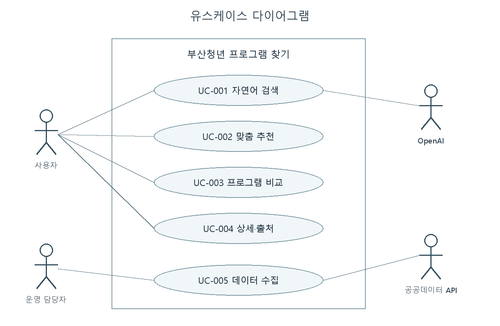

# 소프트웨어 요구사항명세서

버전 0.3 · 2026-10-26 · 소프트웨어공학 1분반 10팀

## 1 문서 개요

이 문서는 부산청년 프로그램 찾기의 기능과 검증 기준을 정한다. 대상 독자는 팀원과 담당 교수이다. 구현 범위는 자연어 검색, 조건 기반 추천, 프로그램 비교이며 실제 신청·결제·예약은 제외한다.

LLM은 자연어 조건을 읽는 언어 모델, SRS는 요구사항명세서, SDD는 설계서를 뜻한다. 이번 버전에는 VLM·벡터 DB·사용자 계정을 사용하지 않는다.

## 2 전체 설명

### 제품과 사용자

독립적인 웹 서비스이며 부산광역시 공공데이터와 OpenAI API를 사용한다. 일반 사용자는 로그인 없이 검색한다. 운영 담당자는 CLI로 데이터 수집을 실행한다. 별도 관리자 화면은 없다.

Python 3.12, Flask, SQLite, HTML/CSS/JavaScript로 구성한다. 데스크톱 Chrome·Edge를 목표로 하고 좁은 화면 배치도 작성했다. 실제 브라우저별 동작 검증은 아직 미완료이다.

### 제약과 의존성

외부 서비스의 인증·호출 제한과 데이터 품질에 의존한다. 전용 비용·주소 필드가 없으므로 무료·지역구·지도 조건은 제외한다. 원천 모집 상태 필터의 불일치가 관측되어 서버에서 수집본을 검사한다. 참가 자격과 실제 접수 여부는 원문 확인이 필요하다. 키는 서버에서만 사용한다.

## 3 기능 요구사항

Must는 현재 구현 대상으로 정한 필수 기능이다. 상세 사용자 흐름은 유스케이스 문서와 연결한다.

| ID | 이름 | 요구사항 | 우선순위 | 검증 기준 |
|---|---|---|---|---|
| FR-001 | 자연어 해석 | 시스템은 질문에서 지원하는 조건을 추출해 수정 가능한 입력 폼에 표시해야 한다. | Must | 질문의 기대 조건과 출력 비교, 사용자 확인 후 검색 |
| FR-002 | 데이터 검색 | 시스템은 확인된 DB 데이터에서 분야·키워드·대상·신청기간 조건에 맞는 항목을 검색해야 한다. | Must | 통제 데이터의 기대 ID 집합과 비교 |
| FR-003 | 추천 | 시스템은 현재 신청기간인 후보를 우선하고 조건 일치 점수·마감일·ID 순으로 정렬하며 근거를 표시해야 한다. | Must | 정렬 결과와 각 근거를 원본·점수 규칙에 대조 |
| FR-004 | 비교 | 시스템은 서로 다른 프로그램 2~3개의 동일 항목을 비교해야 한다. | Must | 선택 항목만 반환, 중복·잘못된 ID·선택 수 거부 |
| FR-005 | 상세·출처 | 시스템은 상세 정보와 데이터 출처·수집 시점을 표시하고 형식이 유효한 HTTP(S) 홈페이지 URL만 링크로 제공해야 한다. | Must | 누락·부적합 URL은 확인 불가, 없는 신청 URL을 생성하지 않음 |
| FR-006 | 결과 없음 | 시스템은 0건일 때 조건을 유지하고 조건 완화를 안내해야 한다. | Must | 임의 결과나 자동 조건 변경 없음 |
| FR-007 | 모집 판정 | 시스템은 날짜와 원천 모집 상태를 직접 비교하고 충돌·누락 시 확인 필요로 표시해야 한다. | Must | 경계일·누락·충돌·마감 사례 확인 |
| FR-008 | 수집·저장 | 시스템은 전체 응답을 검증하고 중복을 처리해 저장하며 실패 시 이전 수집본을 유지해야 한다. | Must | 반복 수집, 불완전 페이지, 외부 오류에서 데이터 보존 |

## 4 비기능 요구사항

| ID | 이름 | 요구사항 | 우선순위 | 검증 기준 |
|---|---|---|---|---|
| NFR-001 | 장애 처리 | 시스템은 외부 요청에 25초 제한을 적용하고 실패를 안내해야 한다. | Must | 예외 주입에서 무한 대기·불확정 성공 없음 |
| NFR-002 | 키 보호 | 시스템은 키를 서버 설정에서 읽고 브라우저 응답·Git·오류 원문에 포함하지 않아야 한다. | Must | 설정·응답·로그·추적 파일 확인 |
| NFR-003 | 개인정보 | 시스템은 실명·연락처·정확한 위치를 요구하지 않고 원문 질문을 DB에 저장하지 않아야 한다. | Must | 입력 화면과 스키마 확인, 제공자 전송 안내 |
| NFR-004 | 사용성 | 시스템은 목표 브라우저에서 검색·상세·비교를 사용할 수 있어야 한다. | Must | Chrome·Edge와 좁은 화면에서 수동 확인, 현재 미완료 |
| NFR-005 | 유지보수 | 시스템은 데이터 호출·DB·AI·업무 로직을 분리하고 외부 호출을 대체해 테스트할 수 있어야 한다. | Must | 외부 호출 없는 오프라인 테스트 |

응답시간 목표는 외부 모델과 네트워크에 영향을 받으므로 일정한 초 이내를 보장한다고 쓰지 않는다. 현재 실행 결과의 관측 시간은 별도로 기록한다.

## 5 유스케이스

주 액터는 일반 사용자, 운영 담당자이며 보조 액터는 OpenAI와 공공데이터 API이다. 검색·추천·비교·상세·데이터 수집의 흐름과 사전조건·예외는 [유스케이스 명세](use-cases.md)에 있다.

## 6 UI와 UX 요구사항

| 화면 | 목적 | 관련 요구사항 |
|---|---|---|
| 질문·조건 폼 | AI 조건 확인, 수정, 수동 검색 | FR-001, FR-006 |
| 결과·추천 목록 | 후보, 추천 이유, 비교 선택 | FR-002, FR-003 |
| 상세 창 | 대상 원문, 일정, 기관, 출처 | FR-005, FR-007 |
| 비교 창 | 선택 프로그램의 동일 항목 비교 | FR-004 |

실제 화면 파일은 frontend에 있다. [화면 구성도](diagrams/screens.png)를 제출 문서의 와이어프레임 자료로 사용할 수 있다. 브라우저에서 렌더링한 캡처는 아직 없다. AI 조건을 읽은 뒤 자동 검색하지 않고 사용자의 확인을 받는다.

## 7 데이터 요구사항

DATA-01은 부산광역시 청년지원프로그램 API의 JSON 응답이다. 원본 필드·누락값·이용조건은 [데이터 검증](data-api-review.md)을 따른다. SQLite에는 정규화 정보, 출처, 실제 수집 시점, 수집 실행 기록을 저장한다.

전용 원천 ID가 없어 완전 중복만 제거한다. 등록일은 최종 수정일과 다르다. 홈페이지는 신청 전용 페이지라고 단정하지 않는다. 사용자 이미지와 질문 이력은 수집·저장 범위 밖이다.

## 8 AI 요구사항

| ID | 요구사항 | 검증 기준 |
|---|---|---|
| AI-REQ-01 | 시스템은 LLM 조건을 스키마·값으로 검증하고 미지원 조건을 적용하지 않아야 한다. | 잘못된 JSON·날짜·무료·지역 조건 검사 |
| AI-REQ-02 | 시스템은 프로그램 사실과 추천 근거를 실제 검색 결과와 서버 규칙에서만 가져와야 한다. | 후보 밖 프로그램·임의 날짜·URL 출력 없음 |
| AI-REQ-03 | 시스템은 AI 실패 시 정상 처리로 표시하지 않고 재시도 또는 수동 검색을 안내해야 한다. | 모델 연결·불완전 응답·잘못된 출력 검사 |

LLM은 OpenAI gpt-4o-mini를 사용한다. 사용자 질문과 검색 조건 설명만 전달하며 프로그램 전체를 매번 전송하지 않는다. 실제 질문 4개를 사용한 소규모 점검은 수행했지만 일반적인 해석 정확도를 입증한 것은 아니다.

## 9 인수 기준

| ID | 기준 | 관련 요구사항 | 확인 방법 |
|---|---|---|---|
| AC-001 | 질문을 해석하고 실제 DB 후보를 찾는다. | FR-001, FR-002 | 실제 LLM·API 통합 점검 |
| AC-002 | 추천 이유가 확인된 값과 일치한다. | FR-003, AI-REQ-02 | 규칙·통합 테스트 |
| AC-003 | 2~3개를 비교하고 잘못된 선택을 거부한다. | FR-004 | API 테스트, 화면 확인은 남음 |
| AC-004 | 상세에서 출처·수집 시점을 확인한다. | FR-005 | API 테스트, 화면 확인은 남음 |
| AC-005 | 0건·누락·외부 실패에서 임의 사실을 만들지 않는다. | FR-006, FR-007, AI-REQ-03 | 예외 테스트 |

## 10 요구사항 추적표

[테스트 계획의 추적표](test-plan.md)에 요구사항–유스케이스–컴포넌트–테스트를 연결했다. 테스트 계획과 [실행 결과](test-results.md)는 구분한다.

## 11 승인

문서는 구현 확인용 초안이다. 팀 대표와 검토자가 실제 확인한 뒤 이름·날짜를 기입한다. 팀원 실명·학번과 교수명은 아직 기입하지 않았다.
