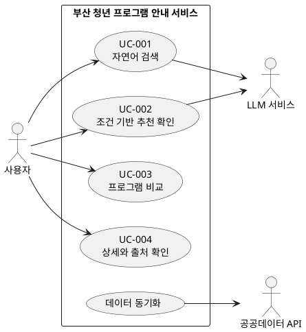

# 유스케이스 초안

작성일 2026-10-25 · 담당 계획 팀원 3 · 상태 검토 전

## 액터와 경계

주 액터는 일반 사용자이다. 외부 데이터 API와 LLM 서비스는 시스템과 통신하는 보조 액터이다. 데이터 동기화는 초기 설계상 서버 작업으로 수행하며 관리자 화면은 범위 밖이다.

## 유스케이스 목록

| ID | 이름 | 관련 요구사항 |
|---|---|---|
| UC-001 | 자연어로 프로그램 검색 | FR-001, FR-002, FR-006 |
| UC-002 | 조건 기반 추천 확인 | FR-003 |
| UC-003 | 프로그램 비교 | FR-004 |
| UC-004 | 상세 정보와 출처 확인 | FR-005, FR-007 |

검색과 추천은 별도 사용자 행동으로 정의한다. 검색은 조건에 맞는 후보 집합을 제공하며 추천은 사용자가 제공한 우선 조건에 따라 후보의 순위와 근거를 제공한다. 별도 화면 또는 동작을 최종 화면 흐름에서 확정한다.

## 다이어그램 원본

아래 PlantUML 코드는 제출 문서에 삽입할 그림의 원본이다. 렌더링한 그림은 아직 생성하지 않았다.

## UC-001 자연어 검색

- 액터: 사용자
- 사전조건: 검색 가능한 검증 데이터가 수집되어 있다.
- 트리거: 사용자가 질문을 제출한다.
- 기본 흐름: 질문 입력 → 서버 검증 → LLM 조건 추출 → 스키마·조건 검증 → 실제 데이터 검색 → 적용 조건과 후보 표시.
- 대안: 조건이 모호하면 재질문하거나 사용자가 조건을 수정한다. 결과가 없으면 0건과 완화 제안을 표시한다. 필수 조건이 미상이면 충족 후보로 단정하지 않는다.
- 예외: LLM 또는 데이터 접근 실패 시 실패 안내를 제공한다.
- 사후조건: 검색 결과와 적용 조건을 확인하거나 실패 이유를 확인한다.
- 관련 요구사항: FR-001, FR-002, FR-006, AI-REQ-01, AI-REQ-03.

## UC-002 조건 기반 추천 확인

- 액터: 사용자
- 사전조건: 검증된 후보가 있으며 사용자가 우선 조건을 제시했다.
- 트리거: 사용자가 맞춤 추천을 요청한다.
- 기본 흐름: 조건 확인 → 후보 조회 → 서버에서 일치 여부·순위 계산 → 확인된 근거의 설명 생성·검증 → 추천과 미상 조건 표시.
- 대안: 조건이 부족하면 추가 조건을 요청한다. 동점 후보는 사전에 정한 결정적 기준으로 정렬한다. 이 기준은 실제 필드 확인 후 확정한다.
- 예외: 설명 생성 실패 시 서버가 계산한 조건별 근거를 정해진 형식으로 표시하거나 실패 안내를 제공한다.
- 사후조건: 사용자는 추천 이유와 제한사항을 확인한다.
- 관련 요구사항: FR-003, AI-REQ-02, AI-REQ-03.

## UC-003 프로그램 비교

- 액터: 사용자
- 사전조건: 조회 가능한 후보가 2개 이상 있다.
- 트리거: 사용자가 2~3개 항목을 선택하고 비교를 요청한다.
- 기본 흐름: 선택 ID 검증 → 해당 데이터 조회 → 동일 항목의 비교표 표시 → 상세 화면으로 이동.
- 대안: 2개 미만이면 추가 선택을 안내하고, 3개를 초과하면 선택 수를 제한한다. 누락된 값은 확인 불가로 표시한다.
- 예외: 삭제·변경 등으로 조회할 수 없는 ID는 안내하고 나머지 선택을 보존한다.
- 사후조건: 프로그램 간 확인된 정보를 비교한다.
- 관련 요구사항: FR-004, FR-005.

## UC-004 상세 정보와 출처 확인

- 액터: 사용자
- 사전조건: 조회할 프로그램 ID가 있다.
- 트리거: 사용자가 상세 보기를 선택한다.
- 기본 흐름: ID 검증 → 상세 조회 → 원본 기반 정보, 출처, 실제 수집 시점 표시 → 사용자가 원문 확인.
- 대안: 프로그램별 공식 링크가 없으면 데이터 출처만 제공하며 신청 링크를 만들어내지 않는다. 신청기간을 해석할 수 없으면 원문과 미상 표시를 제공한다.
- 예외: 항목이 없으면 찾을 수 없음을 안내한다.
- 사후조건: 사용자가 확인된 정보와 원문 확인 경로를 얻는다.
- 관련 요구사항: FR-005, FR-007.
