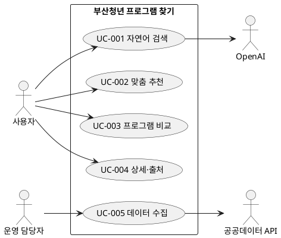

# 유스케이스 명세

버전 0.3 · 2026-10-26

## 액터와 목록

사용자는 프로그램을 찾고 비교한다. 운영 담당자는 CLI로 수집을 실행한다. 외부 OpenAI는 조건 추출, 부산 공공데이터 API는 원본 제공을 담당한다. 관리자 화면은 만들지 않았다.

| ID | 이름 | 관련 요구사항 |
|---|---|---|
| UC-001 | 자연어로 검색 | FR-001, FR-002, FR-006 |
| UC-002 | 맞춤 추천 확인 | FR-003 |
| UC-003 | 프로그램 비교 | FR-004 |
| UC-004 | 상세·출처 확인 | FR-005, FR-007 |
| UC-005 | 데이터 수집 | FR-008 |

## UC-001 자연어 검색

- 액터: 사용자
- 사전조건: DB에 수집된 데이터가 있고 AI 키가 설정되어 있다. 수동 검색에는 AI 키가 필요 없다.
- 트리거: 질문을 적고 조건 읽기를 누른다.
- 기본 흐름: 서버 입력 검사 → LLM 조건 추출 → 서버 검증 → 폼에 조건 표시 → 사용자 확인·수정 → 검색 실행 → 결과 표시.
- 대안: 사용자가 직접 조건 폼을 입력한다. 지원하지 않는 무료·장소 조건은 적용 불가로 표시한다. 키워드는 하나라도 포함되면 검색한다.
- 예외: AI 실패는 수동 검색을 안내한다. DB 미수집은 별도 오류로 안내한다. 결과가 0건이면 조건을 그대로 유지한다.
- 사후조건: 적용한 조건과 실제 후보 또는 실패 이유를 확인한다.
- 관련 요구사항: FR-001, FR-002, FR-006, AI-REQ-01, AI-REQ-03.

## UC-002 맞춤 추천

- 액터: 사용자
- 사전조건: 검색 조건이 정해져 있고 수집 데이터가 있다.
- 트리거: 맞춤 추천 탭을 선택한다.
- 기본 흐름: 조건에 맞는 후보 조회 → 서버 점수 계산 → 현재 신청기간·점수·마감일 순 정렬 → 일치 이유 표시.
- 대안: 조건이 거의 없으면 개인화 근거가 적다. 같은 점수는 마감일과 ID로 순서를 정한다.
- 예외: 후보가 없으면 조건 완화를 안내하며 추천을 만들어내지 않는다.
- 사후조건: 후보와 추천 근거를 확인한다. 참가 자격을 확정하지 않는다.
- 관련 요구사항: FR-003, AI-REQ-02.

## UC-003 비교

- 액터: 사용자
- 사전조건: 비교할 수 있는 항목이 2개 이상 있다.
- 트리거: 2~3개를 비교에 담고 비교하기를 누른다.
- 기본 흐름: 개수·중복·ID 검사 → 현재 데이터 조회 → 대상·기간·기관·문의·링크 비교표 표시.
- 대안: 1개만 선택하면 비교 버튼이 비활성화된다. 4개째는 선택 제한 안내가 나온다. 누락값은 확인 불가로 표시한다.
- 예외: 수집 갱신으로 ID가 비활성화되었으면 다시 검색하도록 안내한다.
- 사후조건: 선택 항목의 확인된 정보를 나란히 볼 수 있다.
- 관련 요구사항: FR-004, FR-005.

## UC-004 상세·출처 확인

- 액터: 사용자
- 사전조건: 현재 데이터의 프로그램 ID가 있다.
- 트리거: 자세히 보기를 누른다.
- 기본 흐름: ID 조회 → 상세 창에 대상 원문·일정·기관·상태·수집 시점 표시 → 홈페이지 또는 데이터 출처 확인.
- 대안: 홈페이지가 없거나 형식이 부적합하면 링크를 만들지 않는다. 데이터 출처 링크는 제공한다.
- 예외: 항목이 없으면 찾을 수 없음을 안내한다. 모집 상태·날짜가 다르면 확인 필요로 표시한다.
- 사후조건: 실제 정보와 원문 확인 경로를 얻는다.
- 관련 요구사항: FR-005, FR-007.

## UC-005 데이터 수집

- 액터: 운영 담당자
- 사전조건: API 키가 설정되어 있고 서버의 DB 경로에 쓸 수 있다.
- 트리거: manage.py sync 실행
- 기본 흐름: 실행 기록 생성 → 페이지별 조회 → 응답·전체 건수 확인 → 정규화·완전 중복 처리 → DB를 한 번에 반영 → 건수 출력.
- 예외: 인증·업무 오류, 반복·누락 페이지, 0건 수집, 저장 실패 시 기존 유효 데이터를 유지하고 실패 기록을 남긴다.
- 사후조건: 성공한 수집본 또는 이전 수집본이 조회 가능하다.
- 관련 요구사항: FR-008, NFR-001, NFR-002.

## 다이어그램 원본

